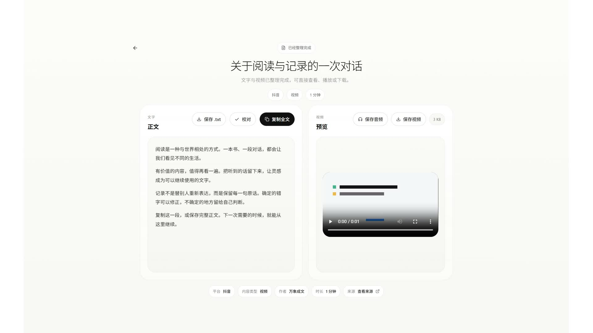
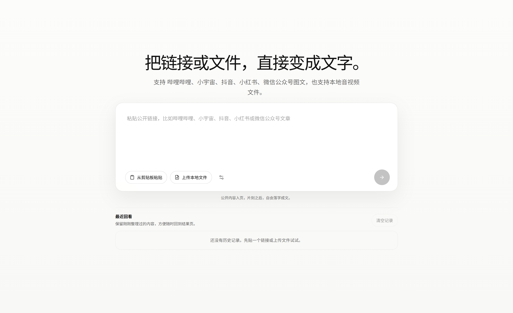
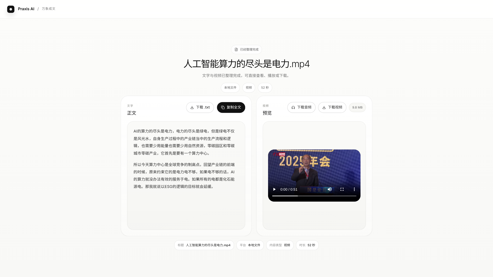

# 万象成文

**把链接或文件，直接变成文字。**

视频里的观点、播客里的对话、图文里的灵感，都可以留下来。万象成文把链接和本地音视频，整理为可阅读、可复制、可保存的文字与媒体。

[产品官网](https://qinxujunai.github.io/Audio2Text/) · [下载 Windows 版](https://github.com/qinxujunai/Audio2Text/releases/latest/download/Wanxiang-Windows-x64-Setup.exe) · [版本记录](https://github.com/qinxujunai/Audio2Text/releases)

*12 秒演示来自实际安装界面，使用专用示例与预置结果，不代表处理耗时。*

## 留下内容，随时回看

| 你带来的内容 | 万象成文为你留下 |
| --- | --- |
| 视频与播客链接 | 可阅读的正文，以及可预览、可保存的原视频和音频 |
| 图文链接 | 正文、图片与可下载的图片包；可用时保留 Live 片段 |
| 本地音频与视频 | 在这台电脑上识别的文字，可复制或保存为文件 |

粘贴链接或选择文件，等待处理完成，即可在同一页查看结果。最近记录保留在本机，方便接着读、再回看。

支持 YouTube、哔哩哔哩、小宇宙、抖音、小红书和微信公众号图文。平台下架、访问限制、网络或账号验证会影响提取；需要你处理时，界面会说明下一步。支持平台不等于任何链接都能成功。

## 在自己的电脑上使用

1. 下载 Windows 安装包，安装并打开万象成文。
2. 首次使用按提示准备本地识别与媒体组件，无需安装 Python。
3. 粘贴公开内容链接，或上传本地音视频，查看并保存结果。

Windows 10 / 11 x64。基础识别与媒体组件首次约下载 222 MB，之后可在本机识别音视频。浏览器提取复用系统 Edge。运行组件提供完整性校验；平台链接仍需要网络访问。

## 原文，由你决定怎么改

本轮 2.3 候选版本增加保守 AI 校对：只提出明确错误的修正建议，由你逐处确认，再另存校对版。原文保留，两版分别下载。开始校对前，界面会说明文字将发送至你配置的服务，费用由该服务决定。

地址与密钥填写后可以检测模型，也可以手动填写；“测试校对”用专用短示例检查实际返回。“已保存”与“测试通过”分别显示。长文按块保留进度，取消或失败后可以继续。密钥按 Windows 当前用户加密保存在本机。

具备兼容 NVIDIA 显卡的电脑可准备 SenseVoice CUDA 组件，并验证实际执行设备。显式 CUDA 失败会明确提示。CPU 兼容路线与 CUDA 路线的权重不同；[测评报告](docs/ascend-accuracy-20261012.md) 区分模型质量与相同权重的设备加速。

**发布状态：2.3.0 已完成本机候选安装与交互验收，正式发布门槛仍在验证。公开下载以 GitHub Release 为准，目前仍为 2.1.0。上述校对与 CUDA 配置改进属于本轮候选功能。**

## 了解更多

- [本轮实施与发布状态](docs/release-2.3.0.md)
- [本地 CUDA 与校对说明](docs/local-cuda-proofreading-plan.md)
- [交互与实际安装验证](docs/interaction-refinement-20261012.md)
- [开发、部署与维护](docs/developer-guide.md)
- [许可证](LICENSE)与[第三方声明](THIRD_PARTY_NOTICES.md)
- [反馈问题](https://github.com/qinxujunai/Audio2Text/issues)

当前公开安装包未代码签名。下载时请核对 Release 提供的 SHA-256；首次遇到系统安全提示时，先确认文件来自上述官方仓库。

应用截图（专用公开示例）

Praxis AI｜无界笃行
